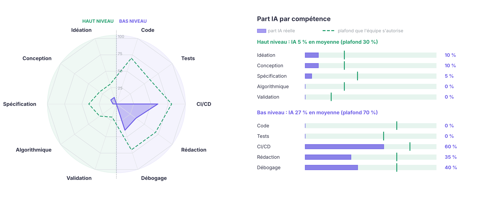

# Kadi

*Les bons comptes font les bonnes courses.*

**Dossier de lancement** · M1 MIAGE Apprentissage · Université Paris Nanterre · rendu R1 du 20 octobre 2026 · v0.1.2  
Amal BENATALLAH, Adam BENDJEBBAR, Assia FERRADJ

## 01 Équipe, comptes développeurs et dépôt

Nous sommes trois apprentis en première année de master MIAGE et nous construisons Kadi à parts égales. Chacun suit un fil rouge pendant toute la durée du projet, ce qui lui donne une responsabilité de bout en bout et une feature à défendre à chaque livraison.

| Membre | Compte GitHub | Email des commits | Fil rouge |
|---|---|---|---|
| Amal BENATALLAH | [@Amalbenatallah](https://github.com/Amalbenatallah) | 42005281@parisnanterre.fr | L'optimisation de la décision d'achat |
| Adam BENDJEBBAR | [@AdamBendjebbar](https://github.com/AdamBendjebbar) | 43006224@parisnanterre.fr | Le juste prix |
| Assia FERRADJ | [@AssFrdz](https://github.com/AssFrdz) | 45008425@parisnanterre.fr | La donnée d'achat et son histoire |

Chaque membre porte une feature par version (section 04) et a vérifié que son email Git est associé à son compte GitHub, pour que ses commits lui soient bien attribués.

**Nos dépôts.** Le dépôt principal contient le serveur et ce dossier dans `/doc`.  
Dépôt principal : <https://github.com/AssFrdz/Kadi-back>  
Front : <https://github.com/AssFrdz/Kadi-front>  
La publication du dossier avec GitHub Pages est prévue pour le rendu 2. Le lien sera communiqué une fois la mise en ligne vérifiée.

## 02 Projet et caractère innovant

**Le constat.** Samedi matin, au rayon petit-déjeuner. Une mère de famille compare deux paquets de céréales, tente une règle de trois de tête, s'arrête devant une étiquette « −25 % », puis repose tout et reprend sa marque habituelle. Elle n'a rien d'une cliente distraite. Il lui manque une information que personne ne lui donne, et le temps de la chercher.

Depuis 2021, le prix des courses est devenu un sujet de tension dans beaucoup de foyers. En avril 2023, les prix alimentaires dépassaient déjà de 21 % leur niveau moyen de 2019 (Insee). Aujourd'hui encore, un panier représentatif de 150 € coûte une vingtaine d'euros de plus selon l'enseigne (palmarès UFC-Que Choisir de septembre 2026, voir références en section 09). Les ménages comparent donc, et souvent beaucoup. Trois mécanismes leur échappent pourtant, parce qu'aucun ne se lit sur l'étiquette.

**La réduflation.** Un paquet de biscuits passe de 200 g à 180 g sans changer de prix. Le prix au kilo vient d'augmenter de 200 ÷ 180 − 1, soit 11,1 %. Depuis juillet 2024, les magasins de plus de 400 m² doivent le signaler, mais pendant deux mois seulement. Passé ce délai, plus rien ne le rappelle.

**La fausse bonne affaire.** La loi impose de calculer une réduction à partir du prix le plus bas pratiqué dans les 30 jours précédents (article L112-1-1 du Code de la consommation). Pour le vérifier en rayon, il faudrait se souvenir des prix du mois dernier. Personne ne le fait.

**Le détour qui coûte.** Faire 8 km de plus pour gagner 3 € semble raisonnable. Au barème kilométrique fiscal de 2026, soit 0,636 € le kilomètre pour une voiture de 5 CV, ce détour coûte 8 × 0,636 = 5,09 €. L'économie est négative avant même de compter le temps passé.

Les outils qui existent, comparateur d'enseigne, palmarès national ou base ouverte de prix, répondent bien à la question « où est-ce le moins cher ? ». Les ménages que nous visons s'en posent une autre, plus directe : est-ce que je me fais avoir, et qu'est-ce que je fais cette semaine avec ce qu'il me reste ?

**Ce que Kadi apporte.** Kadi transforme ces angles morts en informations chiffrées, puis en décisions.

| Ce qui existe | Ce que fait Kadi | Le calcul derrière |
|---|---|---|
| Open Prices : relevés de prix collaboratifs | Donne un prix de référence qu'une erreur de saisie ne peut pas fausser, avec sa confiance et ses relevés | médiane pondérée, écart absolu médian |
| Sites de drive des enseignes, par exemple E.Leclerc Drive | Ne garde que les magasins qui valent le coup et montre leur compromis : le moins cher, le plus proche, le prix le plus sûr | front de Pareto |
| Sites de drive des enseignes : affichage des promotions | Confronte le prix de référence annoncé au plus bas prix relevé sur les 30 jours précédents, et calcule ce qu'une offre « 2e à −50 % » rapporte vraiment par unité | minimum glissant sur 30 jours, prix unitaire effectif |
| Google Maps : estimation d'itinéraires | Cherche où acheter la liste réelle du ménage sous contraintes (nombre de magasins, temps, voiture ou non) et affiche l'économie nette | Σ prix + trajet minimal (Held–Karp) |
| Insee : indice des prix à la consommation | Mesure l'inflation propre au ménage, rayon par rayon, et repère la réduflation même quand le code-barres change avec la quantité | indices de Laspeyres et de Fisher chaînés |
| Open Food Facts : fiches et composition des produits | Propose une alternative en disant ce qui change (quantité, composition, prix unitaire), sans jamais remplacer un article sans accord | contraintes + sac à dos à choix multiples |
| Open Prices : historique des relevés | Prévient quand un produit habituel baisse durablement, pas pour une promotion d'un jour | médiane glissante, CUSUM |

**Positionnement.** Kadi s'adresse d'abord aux ménages qui comptent chaque euro sans avoir le temps de tout vérifier : familles monoparentales, retraités, étudiants, actifs qui font leurs courses en drive. Sa promesse est simple, payer le juste prix et savoir pourquoi. Le socle de comparaison restera gratuit. Deux pistes de revenus seront étudiées : un sponsoring individuel permettant à un magasin d'apparaître en tête dans un emplacement clairement identifié comme « Sponsorisé », et une offre premium proposant des fonctionnalités avancées. La mise en avant sponsorisée restera distincte du classement organique et ne modifiera ni ses critères ni ses résultats. Nous étudierons aussi une offre de suivi d'un panier de référence pour les structures qui accompagnent les ménages, comme les CCAS ou les associations. Ces pistes seront confrontées à une dizaine d'entretiens avant tout développement.

**Inflation et budget du ménage.** L'indice d'inflation personnelle mesure l'évolution du prix d'un panier d'achats ; il ne nécessite pas le salaire. Le ménage pourra, s'il le souhaite, renseigner ses revenus, dont le salaire, et ses dépenses récurrentes pour estimer son budget disponible. Ces montants restent facultatifs et distincts du calcul de l'inflation.

**La donnée d'abord.** Le défi de Kadi tient moins au code qu'à la qualité des prix. Chaque prix affiché porte sa source et sa date, et le catalogue de démonstration est présenté comme tel. Les prix proviennent de sources autorisées, la base ouverte Open Prices et les tickets de caisse que les utilisateurs choisissent de partager, branchées derrière une même interface pour qu'aucune ne soit indispensable. Les fiches produits viennent d'Open Food Facts et les indices nationaux de l'Insee. Aucun prix ne repose sur un relevé isolé : chacun est confronté aux autres relevés du même produit avant d'être affiché.

> **Ce que l'étiquette ne dit pas, Kadi le calcule.**

## 03 Scénarios d'usage

Chaque scénario part d'une situation vécue par un ménage et désigne la feature qui y répond. Ses chiffres serviront de jeu de données au test de bout en bout de la livraison indiquée.

**Inès tape sa liste comme elle parle.** « lait », « pâtes barilla », « coca 6 ». Kadi reconnaît le lait demi-écrémé 1 L et le pack de Coca-Cola 6 × 33 cl, et ne lui pose qu'une question : quelles pâtes Barilla ? Elle choisit, et Kadi s'en souviendra la semaine suivante. Une ligne qu'il ne reconnaît pas reste signalée, jamais devinée. *Construire ma liste, v0.1.0.*

**Karim, en rayon, tape 0,10 € au lieu de 1,10 €.** Au Leclerc de Clichy, le lait demi-écrémé 1 L a une référence de 1,09 €, calculée sur les relevés de cinq personnes. Kadi arrête la saisie de Karim : ce prix est inhabituel, il faut le confirmer. Parmi les relevés existants, une saisie identique à 0,10 € a déjà été écartée, et un contributeur qui a saisi 1,15 € cinq jours de suite ne compte que pour un. La référence reste à 1,09 € avec une confiance élevée, là où la moyenne des relevés afficherait 1,02 €. *Prix fiable, v0.1.0.*

**Karim cherche où acheter sa lessive.** Sur douze magasins connus autour de chez lui, Kadi n'en garde que trois : le moins cher, à 4,2 km, le plus proche, pour 1,45 € de plus, et un compromis à 1,8 km. Les neuf autres sont écartés, chacun battu à la fois sur le prix et sur la distance par l'un des trois, et Kadi dit lequel. *Où acheter ce produit, v0.1.0.*

**Thomas photographie son ticket de drive.** Kadi reconnaît 38 lignes, en laisse deux à confirmer et trouve 6,00 € d'écart avec le total imprimé. Il en propose la cause : une ligne lue 7,29 € au lieu de 1,29 €. Thomas corrige d'un geste, et réimporter le même ticket ne crée aucun doublon. *Import de tickets, v0.2.0.*

**Marc, 74 ans, sans voiture.** Il a deux supermarchés à pied de chez lui et une certitude : le premier est le moins cher, tout le quartier le dit. Kadi compare les deux sur ce que Marc achète vraiment, à partir de ses deux derniers mois de tickets. Sur son panier de 210 € par mois, riche en produits frais, c'est le second qui revient 7 % moins cher, soit 15 € par mois. La contrainte « un seul magasin, accessible à pied » entre directement dans le calcul. *Optimiser ma liste avec un seul arrêt, v0.2.0.*

**Léa, devant une lessive à « −25 % ».** Le prix barré affiche 12,99 €, le prix promotionnel 9,74 €. Elle scanne le code-barres. Kadi a relevé ce même produit à 9,49 € dans ce magasin il y a trois semaines. Comparée au plus bas prix des 30 derniers jours, la promotion est en fait une hausse de 2,6 %, et l'enseigne voisine vend la même lessive 8,95 €. Kadi se garde de parler d'infraction. Il montre ses relevés, chacun avec sa date, et laisse Léa juger. *Vérification des promotions, v0.2.0.*

**Nadia et ses deux ados.** Les biscuits du goûter coûtent toujours 2,19 €, mais le paquet est passé de 200 g à 180 g. Le prix au kilo grimpe de 10,95 € à 12,17 €. Le code-barres a changé avec la quantité, comme l'imposent les règles GS1, alors Kadi relie l'ancien et le nouveau produit grâce à son moteur de rapprochement. Dans le détail de son inflation, Nadia voit la hausse réelle du prix au kilo, que l'étiquette ne montrait plus. *Mon inflation et réduflation, v1.0.0.*

**Thomas et Inès, 40 articles en drive.** Leur panier coûte 112 € dans un drive, 98 € s'ils le partagent entre deux. Kadi affiche les 14 € d'écart, puis ce qu'ils coûtent vraiment : 6 km et 20 minutes de plus, soit 3,82 € au barème kilométrique. Il reste 10,18 € gagnés en 20 minutes, autour de 30 € de l'heure. À eux de décider si leur samedi matin vaut ce prix. *Optimiser ma liste et économie nette, v0.2.0.*

**Sonia, 34 ans, seule avec deux enfants, 380 € de courses par mois.** Le 20, il lui reste 90 € pour finir le mois. Elle fixe ce budget à sa liste de la semaine. Kadi ne promet pas de miracle : parmi les remplacements possibles, il choisit la combinaison qui respecte ses exclusions et tient dans le budget, des pâtes et des céréales d'une autre marque au même grammage, qui lui font gagner 6,40 € sans changer de magasin. Chaque échange attend son accord. *Alternatives, v1.0.0.*

**Martine, retraitée, suit son café moulu.** Une promotion d'un jour à −30 % ne déclenche rien. Trois semaines plus tard, le prix baisse durablement de 8 % dans son magasin : Kadi la prévient une seule fois, avec les relevés datés qui le montrent. *Alertes prix, v1.0.0.*

**Yanis, étudiant, 150 € par mois.** Il scanne ses tickets depuis la rentrée. En janvier, Kadi recalcule son panier de septembre aux prix d'aujourd'hui : il coûte 6 % de plus, et la moitié de la hausse vient des produits laitiers. Kadi place ce chiffre à côté de l'indice alimentaire de l'Insee. Yanis sait enfin où part son argent et sur quoi agir, ce qu'une moyenne nationale ne lui aurait jamais dit. *Mon inflation, v1.0.0.*

## 04 Plan des features

Une feature a un effet sur la BD, le back, l'API REST et le front. Chaque feature est portée par une seule personne, repose sur un algorithme identifié et dispose de sa fiche dans `doc/features/`. Chaque algorithme est comparé à une solution de référence exhaustive sur de petites instances.

Chaque fiche de feature précisera son impact sur le modèle de données et les migrations Flyway nécessaires. Le schéma est versionné par des migrations incrémentales ; une feature peut en nécessiter plusieurs.

| Version | Amal BENATALLAH | Adam BENDJEBBAR | Assia FERRADJ |
|---|---|---|---|
| **v0.1.0** 24/11 | **F3 · Où acheter ce produit**<br>front de Pareto sur le prix unitaire, la distance et la confiance du prix, ε-dominance, algorithme de Kung en O(n log n), magasin témoin pour chaque offre écartée | **F2 · Prix fiable**<br>médiane pondérée par la fraîcheur, la preuve et le contributeur (sélection rapide, O(n) en moyenne), écart absolu médian et score z robuste, confiance par taille effective de Kish | **F1 · Construire ma liste**<br>normalisation des libellés et des formats, présélection par trigrammes (`pg_trgm`, index GIN), similarité de Dice, seuils de décision mesurés en précision et rappel |
| **v0.2.0** 08/12 | **F6 · Optimiser ma liste**<br>énumération des ensembles d'au plus k magasins, ordre de visite par Held–Karp en O(m²·2ᵐ) pour tous les ensembles à la fois, front coût/temps | **F5 · Vérification des promotions**<br>minimum glissant sur 30 jours par file monotone en O(n), réductions successives, prix unitaire effectif selon le type de promotion | **F4 · Import de tickets**<br>lecture des lignes par machine à états, affectation des libellés aux produits par l'algorithme hongrois en O(n³), correction par le total, import sans doublon |
| **v1.0.0** 19/01 | **F9 · Alternatives**<br>contraintes dures, similarité dans l'arbre des catégories, sélection sur toute la liste par sac à dos à choix multiples en O(a·B·c) | **F8 · Alertes prix**<br>médiane glissante robuste, détection d'une baisse durable par CUSUM, machine à états avec hystérésis | **F7 · Mon inflation**<br>indices de Laspeyres, Paasche et Fisher chaînés, repli sur les indices Insee par rayon, contribution de chaque rayon, réduflation |

L'application s'organise autour de deux écrans : la liste de courses (F1), d'où partent F4, F6 et F9, et la fiche produit (F3), qui affiche aussi F2, F5 et F8.

## 05 Architecture

```text
 Front ──HTTP/JSON──▶ API REST ──────────▶ Back (cas d'utilisation) ──JPA/SQL──▶ BD
 (web mobile)         (Spring MVC)         (Java 21, hexagonal)                  (PostgreSQL 17)
 Angular, 10 écrans   /api/v1, OpenAPI     9 cas d'utilisation                   ~15 tables
                                           1 par feature                         migrations Flyway

 Produit 1──* ReleveDePrix *──1 Magasin *──1 Enseigne      Menage 1──* ListeDeCourses 1──* Ligne *──1 Produit
 Ticket 1──* LigneDeTicket *──1 Produit                    Menage 1──* ProduitSuivi *──1 Produit
 Port SourceDePrix ◀── OpenPrices | Ticket de caisse | Catalogue de démonstration
 Port FicheProduit ◀── Open Food Facts                     Port IndicesDePrix ◀── Insee
```

| Couche | Choix | Remarques |
|---|---|---|
| Front | Angular et TypeScript, application web mobile installable | Client de l'API REST uniquement, scan du code-barres par la caméra du téléphone, lecture des tickets dans le navigateur pour que la photo ne quitte pas le téléphone, dépôt Kadi-front. |
| API REST | Spring Boot 4 (Spring MVC), OpenAPI et Swagger UI | Versionnée sous `/api/v1`, contrat écrit avant le code pour que le front avance en parallèle, erreurs au format RFC 9457. |
| Back | Java 21, Spring Boot 4, Spring Data JPA, Bean Validation | Architecture hexagonale. Un prix est un relevé daté, jamais un attribut du produit. Montants en `BigDecimal`. |
| BD | PostgreSQL 17 avec l'extension `pg_trgm` | Schéma versionné par des migrations Flyway selon les besoins de chaque feature. Les calculs (médianes, fenêtres, optimisations) restent dans le domaine Java pour être testables sans base. |
| Qualité | JUnit 5, AssertJ, jqwik, ArchUnit, Testcontainers, JaCoCo, SonarCloud | Tests de propriétés face à une solution de référence exhaustive. Tests d'intégration sur un vrai PostgreSQL, car H2 ne gère pas `pg_trgm`. Intégration continue GitHub Actions. |
| Conteneurs | Docker Compose | Base de données dès v0.1.0, application complète en v0.2.0. |

**Modèle et conventions de l'API.** Les tables et relations du schéma ci-dessus sont une anticipation du modèle initial, qui pourra évoluer avec les features. Chaque évolution du schéma est versionnée par Flyway, sans modifier une migration déjà livrée. Les conventions REST s'appliquent à toutes les routes : URI de ressources, verbes HTTP adaptés aux opérations, codes de statut documentés, validation des entrées et erreurs au format RFC 9457. Le contrat OpenAPI décrit ces règles et les réponses de l'API.

**Qualité du code.** Au-delà de l'architecture hexagonale, nous tenons quelques règles simples. Les noms parlent le langage des ménages (`PrixUnitaire`, `ReleveDePrix`, `EconomieNette`). Les objets valeur sont immuables et refusent un état absurde dès leur construction, un prix négatif ou une quantité nulle par exemple. Les design patterns sont utilisés quand ils servent et nommés dans les fiches, Stratégie pour les algorithmes de panier, Adaptateur pour les sources de prix. L'API respecte les conventions REST et les règles de sécurité OWASP, et la quality gate SonarCloud doit rester au vert.

## 06 Démarche pour chaque feature

Les étapes s'enchaînent dans cet ordre, sans en sauter : on ne commence une étape que lorsque la précédente est terminée.

| Étape | Ce qu'on fait | Terminé quand |
|---|---|---|
| 1. Idéation | Besoin et scénario du ménage, algorithme retenu avec sa complexité et les alternatives écartées, impact sur le schéma et l'API, critères d'acceptation. Issue GitHub et fiche dans `doc/features/`. | La fiche est validée par un autre membre. |
| 2. Back | Migration Flyway, domaine en Java pur (modèle, règles, algorithme), application (ports et service), adaptateur de persistance. | Le code compile et ArchUnit passe. |
| 3. Tests | Tests unitaires de l'algorithme sur les cas limites (produit sans code-barres, relevé de plus de 30 jours, unités incompatibles, panier vide), services testés avec de faux adaptateurs, tests d'intégration sur PostgreSQL et tests de validation des critères d'acceptation. | `./gradlew build` passe, les tests d'intégration et de validation passent et chaque critère d'acceptation est couvert. |
| 4. API REST | Endpoints `/api/v1`, DTO validés, erreurs `problem+json`, contrat OpenAPI, tests de l'API. | Visible dans Swagger UI, tests de l'API au vert. |
| 5. Front | Écrans qui consomment uniquement l'API. | Le scénario de la section 03 se joue de bout en bout, la PR est relue, la fiche est complétée avec son araignée. |

**Definition of Done.** Une feature est terminée lorsque sa fiche et ses critères d'acceptation sont validés, son code et ses migrations éventuelles sont relus, les tests unitaires, d'intégration, d'API et de validation passent, et son scénario est vérifié de bout en bout. Le contrat OpenAPI et la documentation sont à jour, la pull request est approuvée et aucun défaut bloquant connu ne subsiste.

## 07 Protocole d'usage de l'IA

**Principe : l'IA assiste, l'humain reste l'auteur.** Nous consultons l'IA comme on consulte un collègue, pour vérifier un fait, contredire une idée déjà formulée ou accélérer une tâche répétitive. Les idées, la conception et le cœur des algorithmes restent notre travail. Tout ce qui est commité a été relu et compris par son auteur, capable de l'expliquer, de le modifier et de le refaire sans aide. Les consignes données aux assistants de code seront versionnées dans `CLAUDE.md`, à la racine du dépôt, dès la livraison v0.1.0.

| Activité | Ce que fait l'IA | Ce que fait l'humain |
|---|---|---|
| Idéation et conception | Aucune proposition. Peut vérifier après coup un fait précis, une règle légale ou une documentation. | Trouve le besoin, conçoit, choisit, justifie et rédige la fiche. |
| Algorithme | Relit et signale un cas oublié, à notre demande. | Conçoit, écrit et prouve le cœur de l'algorithme. |
| Code technique | Peut proposer un premier jet pour le code d'infrastructure (configuration, DTO, mapping). | Écrit le domaine, relit chaque ligne proposée, l'adapte et l'assume. |
| Tests | Peut suggérer des cas supplémentaires. | Définit cas limites et propriétés, vérifie qu'un test échoue quand on casse le code. |
| CI/CD, conteneurisation | Peut générer workflows et Dockerfile. | Comprend chaque étape, vérifie l'exécution, gère les secrets. |
| Documentation | Aide à reformuler et à mettre en forme. | Écrit le fond, valide chaque phrase et vérifie les faits. |

**Interdits.** Commiter du code qu'on ne comprend pas, confier des secrets ou des données personnelles à l'IA, commiter sous une autre identité, présenter comme humain un travail de l'IA.

**Traçabilité.** Chaque pull request contient une section « Usage de l'IA », et les commits concernés portent la mention `Assisted-by`. Un journal, `doc/journal-ia.md`, gardera aussi la trace de ce que nous refusons. Au lancement, nous avons ainsi écarté un backend en Python, contraire à la contrainte Java, une architecture en microservices, disproportionnée pour trois développeurs, et une base H2 pour les tests, qui ne gère pas `pg_trgm`. La part de l'IA est déclarée par compétence, haut niveau et bas niveau, dans le graphe en araignée de l'annexe, face au plafond que l'équipe s'autorise.

## 08 Annexe : part IA / part humaine



Valeurs déclarées par l'équipe et mises à jour à chaque livraison. À partir de v0.1.0, elles seront tenues dans `doc/part-ia.json` et régénérées à chaque compilation du dossier. À la livraison R1, aucune ligne de code applicatif n'existe encore. La part déclarée vient de la mise en place des dépôts, du script qui compile ce dossier et de l'aide au débogage de Git. Les compétences de haut niveau restent humaines, l'IA n'y a servi qu'à vérifier des faits.

## 09 Bibliographie et références

1. **Insee**, *Indice des prix à la consommation — base 2015, ensemble des ménages, France*, série historique arrêtée : <https://www.insee.fr/fr/statistiques/serie/001759970>.
2. **UFC-Que Choisir**, « Livraison de courses — Toujours plus, toujours plus vite ! », enquête, *Que Choisir* n° 595, octobre 2020, p. 54. Référence sur les services de livraison, et non source d'un chiffre sur les écarts de prix entre enseignes : <https://www.quechoisir.org/recherche/?keyword=prix%20des%20supermarches>.
3. **UFC-Que Choisir**, « Grande distribution — On cause plus, on flingue... », enquête, *Que Choisir* n° 563, novembre 2017, p. 27 : <https://www.quechoisir.org/recherche/?keyword=comparateur%20supermarch%C3%A9s>.
4. **Open Food Facts**, *Open Prices*, base collaborative de relevés de prix : <https://prices.openfoodfacts.org/>.
5. **Open Food Facts**, base ouverte de fiches produits : <https://world.openfoodfacts.org/>.
6. **Code de la consommation**, article L. 112-1-1, prix antérieur annoncé lors d'une réduction : <https://www.legifrance.gouv.fr/search/code?query=L112-1-1>.
 