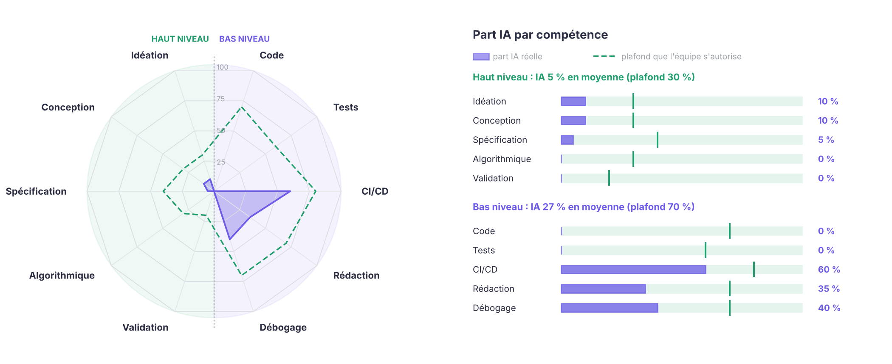

# Kadi

*Les bons comptes font les bonnes courses.*

**Dossier de lancement** · M1 MIAGE Apprentissage · Université Paris Nanterre · rendu R1 du 20 octobre 2026  
Amal BENATALLAH, Adam BENDJEBBAR, Assia FERRADJ

## 01 Équipe, comptes développeurs et dépôt

Nous sommes trois apprentis en première année de master MIAGE et nous construisons Kadi à parts égales. Chacun suit un fil rouge pendant toute la durée du projet, ce qui lui donne une responsabilité de bout en bout et une feature à défendre à chaque livraison.

| Membre | Compte GitHub | Email des commits | Fil rouge |
|---|---|---|---|
| Amal BENATALLAH | [@Amalbenatallah](https://github.com/Amalbenatallah) | 42005281@parisnanterre.fr | La donnée produit et son histoire |
| Adam BENDJEBBAR | [@AdamBendjebbar](https://github.com/AdamBendjebbar) | 43006224@parisnanterre.fr | Le juste prix et le budget |
| Assia FERRADJ | [@AssFrdz](https://github.com/AssFrdz) | 45008425@parisnanterre.fr | La décision d'achat |

Chaque membre porte une feature par version (section 04) et a vérifié que son email Git est associé à son compte GitHub, pour que ses commits lui soient bien attribués.

**Nos dépôts.** Le dépôt principal contient le serveur et ce dossier dans `/doc`.  
Dépôt principal : <https://github.com/AssFrdz/Kadi-back>  
Front : <https://github.com/AssFrdz/Kadi-front>  
Page de projet, publiée avec GitHub Pages à la livraison v0.1.0 : <https://assfrdz.github.io/Kadi-back/>

## 02 Projet et caractère innovant

**Le constat.** Samedi matin, au rayon petit-déjeuner. Une mère de famille compare deux paquets de céréales, tente une règle de trois de tête, s'arrête devant une étiquette « −25 % », puis repose tout et reprend sa marque habituelle. Elle n'a rien d'une cliente distraite. Il lui manque une information que personne ne lui donne, et le temps de la chercher.

Depuis 2021, le prix des courses est devenu un sujet de tension dans beaucoup de foyers. En avril 2023, les prix alimentaires dépassaient déjà de 21 % leur niveau moyen de 2019 (Insee). Aujourd'hui encore, un panier représentatif de 150 € coûte une vingtaine d'euros de plus selon l'enseigne (palmarès UFC-Que Choisir de septembre 2026). Les ménages comparent donc, et souvent beaucoup. Trois mécanismes leur échappent pourtant, parce qu'aucun ne se lit sur l'étiquette.

**La réduflation.** Un paquet de biscuits passe de 200 g à 180 g sans changer de prix. Le prix au kilo vient d'augmenter de 200 ÷ 180 − 1, soit 11,1 %. Depuis juillet 2024, les magasins de plus de 400 m² doivent le signaler, mais pendant deux mois seulement. Passé ce délai, plus rien ne le rappelle.

**La fausse bonne affaire.** La loi impose de calculer une réduction à partir du prix le plus bas pratiqué dans les 30 jours précédents (article L112-1-1 du Code de la consommation). Pour le vérifier en rayon, il faudrait se souvenir des prix du mois dernier. Personne ne le fait.

**Le détour qui coûte.** Faire 8 km de plus pour gagner 3 € semble raisonnable. Au barème kilométrique fiscal de 2026, soit 0,636 € le kilomètre pour une voiture de 5 CV, ce détour coûte 8 × 0,636 = 5,09 €. L'économie est négative avant même de compter le temps passé.

Les outils qui existent, comparateur d'enseigne, palmarès national ou base ouverte de prix, répondent bien à la question « où est-ce le moins cher ? ». Les ménages que nous visons s'en posent une autre, plus directe : est-ce que je me fais avoir, et qu'est-ce que je fais cette semaine avec ce qu'il me reste ?

**Ce que Kadi apporte.** Kadi transforme ces angles morts en informations chiffrées, puis en décisions.

| Ce qui existe | Ce que fait Kadi | Le calcul derrière |
|---|---|---|
| Comparer le prix d'un produit | Suit le prix au kilo dans le temps et repère la réduflation, même quand le code-barres change avec la quantité | prix ÷ quantité nette, variation en % |
| Afficher une promotion | Confronte le prix de référence annoncé au plus bas prix que Kadi a relevé sur les 30 jours précédents | min des prix relevés sur 30 jours |
| Comparer des paniers | Cherche la meilleure répartition sous contraintes réelles (nombre de magasins, voiture ou non) et affiche l'économie nette | Σ prix + coût du trajet |
| Suivre un budget | Mesure l'inflation propre au ménage et projette la fin du mois | Σ pₜ·q₀ ÷ Σ p₀·q₀ |
| Proposer moins cher | Propose une alternative en disant ce qui change (quantité, composition, prix unitaire) | similarité × économie unitaire |

**Positionnement.** Kadi s'adresse d'abord aux ménages qui comptent chaque euro sans avoir le temps de tout vérifier : familles monoparentales, retraités, étudiants, actifs qui font leurs courses en drive. Sa promesse est simple, payer le juste prix et savoir pourquoi. Aucune enseigne ne pourra payer pour être mieux placée, car notre crédibilité repose entièrement sur cette indépendance. L'application restera gratuite pour les ménages. Le modèle économique que nous voulons tester d'ici la v1.0.0 vise les structures qui les accompagnent, CCAS, épiceries solidaires, associations ou comités d'entreprise, avec un suivi du coût d'un panier de référence sur leur territoire. Nous le confronterons à une dizaine d'entretiens avant d'y consacrer du code.

**La donnée d'abord.** Le défi de Kadi tient moins au code qu'à la qualité des prix. Chaque prix affiché porte sa source et sa date, et le catalogue de démonstration est présenté comme tel. Les prix proviennent de sources autorisées, la base ouverte Open Prices et les tickets de caisse que les utilisateurs choisissent de partager, branchées derrière une même interface pour qu'aucune ne soit indispensable.

> **Ce que l'étiquette ne dit pas, Kadi le calcule.**

## 03 Scénarios d'usage

Chaque scénario part d'une situation vécue par un ménage et désigne la feature qui y répond. Ses chiffres serviront de jeu de données au test de bout en bout de la livraison indiquée.

**Sonia, 34 ans, seule avec deux enfants, 380 € de courses par mois.** Le 20, il lui reste 90 €. Kadi a fait le calcul avant elle : à son rythme de 14,50 € par jour, le mois finirait 55 € au-dessus du budget, alors qu'il faudrait tenir avec 9 € par jour. Kadi ne promet pas de miracle. Il propose deux échanges sur sa liste de la semaine, des pâtes et des céréales d'une autre marque au même grammage, qui lui font gagner 6,40 € sans changer de magasin. *Budget et alternatives, v1.0.0.*

**Marc, 74 ans, sans voiture.** Il a deux supermarchés à pied de chez lui et une certitude : le premier est le moins cher, tout le quartier le dit. Kadi compare les deux sur ce que Marc achète vraiment, à partir de ses deux derniers mois de tickets. Sur son panier de 210 € par mois, riche en produits frais, c'est le second qui revient 7 % moins cher, soit 15 € par mois. La contrainte « un seul magasin, accessible à pied » entre directement dans le calcul. *Panier optimisé avec k = 1, v0.2.0.*

**Léa, devant une lessive à « −25 % ».** Le prix barré affiche 12,99 €, le prix promotionnel 9,74 €. Elle scanne le code-barres. Kadi a relevé ce même produit à 9,49 € dans ce magasin il y a trois semaines. Comparée au plus bas prix des 30 derniers jours, la promotion est en fait une hausse de 2,6 %, et l'enseigne voisine vend la même lessive 8,95 €. Kadi se garde de parler d'infraction. Il montre ses relevés, chacun avec sa date, et laisse Léa juger. *Vérification des promotions, v0.2.0.*

**Nadia et ses deux ados.** Les biscuits du goûter coûtent toujours 2,19 €, mais le paquet est passé de 200 g à 180 g. Le prix au kilo grimpe de 10,95 € à 12,17 €. Le code-barres a changé avec la quantité, comme l'imposent les règles GS1, alors Kadi relie l'ancien et le nouveau produit grâce à son moteur de rapprochement avant d'envoyer l'alerte. Il propose dans la foulée un équivalent à 9,45 € le kilo. *Historique et réduflation, v0.2.0.*

**Thomas et Inès, 40 articles en drive.** Leur panier coûte 112 € dans un drive, 98 € s'ils le partagent entre deux. Kadi affiche les 14 € d'écart, puis ce qu'ils coûtent vraiment : 6 km et 20 minutes de plus, soit 3,82 € au barème kilométrique. Il reste 10,18 € gagnés en 20 minutes, autour de 30 € de l'heure. À eux de décider si leur samedi matin vaut ce prix. *Panier optimisé et économie nette, v0.2.0.*

**Yanis, étudiant, 150 € par mois.** Il scanne ses tickets depuis la rentrée. Un an plus tard, Kadi recalcule son panier de septembre aux prix d'aujourd'hui : il coûte 6 % de plus, et la moitié de la hausse vient des produits laitiers. Yanis sait enfin où part son argent et sur quoi agir, ce qu'une moyenne nationale ne lui aurait jamais dit. *Inflation personnelle, v1.0.0.*

## 04 Plan des features

Une feature a un effet sur la BD, le back, l'API REST et le front. Chaque feature est portée par une seule personne et repose sur un algorithme identifié.

| Version | Amal BENATALLAH | Adam BENDJEBBAR | Assia FERRADJ |
|---|---|---|---|
| **v0.1.0** 24/11 | **Catalogue et rapprochement**<br>normalisation des libellés et des formats, similarité par trigrammes (`pg_trgm`) avec index GIN pour éviter la comparaison deux à deux en O(n²), seuil de confiance affiché | **Relevés de prix et prix unitaire**<br>conversion d'unités (g, kg, cl, L, lots) et calcul exact en `BigDecimal`, arrondi au centime seulement à l'affichage | **Comparateur**<br>tri multicritère des offres par prix unitaire, fraîcheur du relevé et confiance du rapprochement, en O(n log n) |
| **v0.2.0** 08/12 | **Historique et réduflation**<br>détection d'une baisse de quantité à prix stable, ancien et nouveau code-barres reliés par le rapprochement | **Vérification des promotions**<br>minimum glissant sur 30 jours par fonction de fenêtre SQL, écart au prix de référence annoncé | **Panier optimisé**<br>énumération des C(m,k) groupes de k magasins, chaque article affecté au moins cher du groupe, trajet compris, en O(C(m,k)·n·k) |
| **v1.0.0** 19/01 | **Inflation personnelle**<br>indice de Laspeyres à panier fixe Σ pₜ·q₀ ÷ Σ p₀·q₀, avec la contribution de chaque rayon | **Budget et fin de mois**<br>projection du rythme de dépense, alerte de dépassement, budget restant par jour | **Alternatives**<br>score de similarité (catégorie, quantité, marque) pondéré par l'économie au prix unitaire, glouton comparé à l'exhaustif |

## 05 Architecture

```text
 Front ──HTTP/JSON──▶ API REST ──────────▶ Back (cas d'utilisation) ──JPA/SQL──▶ BD
 (web mobile)         (Spring MVC)         (Java 21, hexagonal)                  (PostgreSQL 17)
 Angular, 6 écrans    /api/v1, OpenAPI     9 cas d'utilisation                   ~10 tables
                                           1 par feature                         1 migration par feature

 Produit 1──* ReleveDePrix *──1 Magasin *──1 Enseigne      Menage 1──* Panier 1──* LignePanier *──1 Produit
 Port SourceDePrix ◀── OpenPrices | Ticket de caisse | Catalogue de démonstration
```

| Couche | Choix | Remarques |
|---|---|---|
| Front | Angular et TypeScript, application web mobile installable | Client de l'API REST uniquement, scan du code-barres par la caméra du téléphone, dépôt Kadi-front. |
| API REST | Spring Boot 4 (Spring MVC), OpenAPI et Swagger UI | Versionnée sous `/api/v1`, contrat écrit avant le code pour que le front avance en parallèle, erreurs au format RFC 9457. |
| Back | Java 21, Spring Boot 4, Spring Data JPA, Bean Validation | Architecture hexagonale. Un prix est un relevé daté, jamais un attribut du produit. Montants en `BigDecimal`. |
| BD | PostgreSQL 17 avec l'extension `pg_trgm` | Schéma versionné par Flyway, une migration par feature. Fonctions de fenêtre pour l'historique et la règle des 30 jours. |
| Qualité | JUnit 5, AssertJ, ArchUnit, Testcontainers, JaCoCo, SonarCloud | Tests d'intégration sur un vrai PostgreSQL, car H2 ne gère ni `pg_trgm` ni nos requêtes de fenêtre. Intégration continue GitHub Actions. |
| Conteneurs | Docker Compose | Base de données dès v0.1.0, application complète en v0.2.0. |

**Qualité du code.** Au-delà de l'architecture hexagonale, nous tenons quelques règles simples. Les noms parlent le langage des ménages (`PrixUnitaire`, `ReleveDePrix`, `EconomieNette`). Les objets valeur sont immuables et refusent un état absurde dès leur construction, un prix négatif ou une quantité nulle par exemple. Les design patterns sont utilisés quand ils servent et nommés dans les fiches, Stratégie pour les algorithmes de panier, Adaptateur pour les sources de prix. L'API respecte les conventions REST et les règles de sécurité OWASP, et la quality gate SonarCloud doit rester au vert.

## 06 Démarche pour chaque feature

Les étapes s'enchaînent dans cet ordre, sans en sauter : on ne commence une étape que lorsque la précédente est terminée.

| Étape | Ce qu'on fait | Terminé quand |
|---|---|---|
| 1. Idéation | Besoin et scénario du ménage, algorithme retenu avec sa complexité et les alternatives écartées, impact sur le schéma et l'API, critères d'acceptation. Issue GitHub et fiche dans `doc/features/`. | La fiche est validée par un autre membre. |
| 2. Back | Migration Flyway, domaine en Java pur (modèle, règles, algorithme), application (ports et service), adaptateur de persistance. | Le code compile et ArchUnit passe. |
| 3. Tests | Tests unitaires de l'algorithme sur les cas limites (produit sans code-barres, relevé de plus de 30 jours, unités incompatibles, panier vide), services testés avec de faux adaptateurs, intégration sur PostgreSQL. | `./gradlew build` passe et chaque critère d'acceptation est couvert. |
| 4. API REST | Endpoints `/api/v1`, DTO validés, erreurs `problem+json`, contrat OpenAPI, tests de l'API. | Visible dans Swagger UI, tests de l'API au vert. |
| 5. Front | Écrans qui consomment uniquement l'API. | Le scénario de la section 03 se joue de bout en bout, la PR est relue, la fiche est complétée avec son araignée. |

## 07 Protocole d'usage de l'IA

**Principe : l'IA assiste, l'humain reste l'auteur.** Nous consultons l'IA comme on consulte un collègue, pour vérifier un fait, contredire une idée déjà formulée ou accélérer une tâche répétitive. Les idées, la conception et le cœur des algorithmes restent notre travail. Tout ce qui est commité a été relu et compris par son auteur, capable de l'expliquer, de le modifier et de le refaire sans aide. Les consignes données aux assistants de code seront versionnées dans `CLAUDE.md`, à la racine du dépôt, dès la livraison v0.1.0.

| Activité | Ce que fait l'IA | Ce que fait l'humain |
|---|---|---|
| Idéation et conception | Aucune proposition. Peut vérifier après coup un fait précis, une règle légale ou une documentation. | Trouve le besoin, conçoit, choisit, justifie et rédige la fiche. |
| Algorithme | Relit et signale un cas oublié, à notre demande. | Conçoit, écrit et prouve le cœur de l'algorithme. |
| Code technique | Peut proposer un premier jet pour le code d'infrastructure (configuration, DTO, mapping). | Écrit le domaine, relit chaque ligne proposée, l'adapte et l'assume. |
| Tests | Peut suggérer des cas supplémentaires. | Définit cas limites et propriétés, vérifie qu'un test échoue quand on casse le code. |
| CI/CD, conteneurisation | Peut générer workflows et Dockerfile. | Comprend chaque étape, vérifie l'exécution, gère les secrets. |
| Documentation | Aide à reformuler et à mettre en forme. | Écrit le fond, valide chaque phrase et vérifie les faits. |

**Interdits.** Commiter du code qu'on ne comprend pas, confier des secrets ou des données personnelles à l'IA, commiter sous une autre identité, présenter comme humain un travail de l'IA.

**Traçabilité.** Chaque pull request contient une section « Usage de l'IA », et les commits concernés portent la mention `Assisted-by`. Un journal, `doc/journal-ia.md`, gardera aussi la trace de ce que nous refusons. Au lancement, nous avons ainsi écarté un backend en Python, contraire à la contrainte Java, une architecture en microservices, disproportionnée pour trois développeurs, et une base H2 pour les tests, qui ne gère pas `pg_trgm`. La part de l'IA est déclarée par compétence, haut niveau et bas niveau, dans le graphe en araignée de l'annexe, face au plafond que l'équipe s'autorise.

## 08 Annexe : part IA / part humaine



Valeurs déclarées par l'équipe et mises à jour à chaque livraison. À partir de v0.1.0, elles seront tenues dans `doc/part-ia.json` et régénérées à chaque compilation du dossier. À la livraison R1, aucune ligne de code applicatif n'existe encore. La part déclarée vient de la mise en place des dépôts, du script qui compile ce dossier et de l'aide au débogage de Git. Les compétences de haut niveau restent humaines, l'IA n'y a servi qu'à vérifier des faits.
