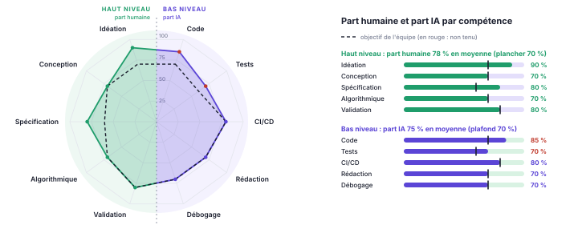

# F1 : Construire ma liste de courses

## Identification de la feature

| Version | Responsable | Algorithme(s) |
|---|---|---|
| v0.1.0 | Assia FERRADJ (`@AssFrdz`) | Rapprochement de libellés : normalisation, présélection par trigrammes et classement par similarité de Dice |

**État :** implémentée pour le périmètre v0.1.0 décrit ci-dessous, avec un utilisateur simulé (sans connexion) ; fiche, migration et contrat à faire relire par un autre membre avant la fusion.

## Issue associée

Issue #7 : https://github.com/AssFrdz/Kadi-back/issues/7
[Feature] F1 — Construire ma liste de courses

## 1. Idéation

### Besoin

Je veux permettre à l'utilisateur de construire facilement sa liste de courses, sans avoir à connaître le nom exact d'un produit ni à savoir à l'avance dans quel magasin il va faire ses achats.

Il peut rechercher un produit en l'écrivant comme il le ferait naturellement. À partir de trois caractères saisis, Kadi lui propose jusqu'à sept suggestions qui évoluent au fur et à mesure. La recherche doit aussi pouvoir retrouver certains produits malgré une erreur de frappe : par exemple, « yaort » doit permettre de trouver des yaourts.
Si davantage de produits correspondent, l'utilisateur peut ouvrir « Voir tous les résultats » pour parcourir et filtrer la liste complète.

Il peut également parcourir les produits par catégorie, puis utiliser les filtres et tris disponibles pour retrouver ce qu'il cherche. Les filtres prévus portent sur la catégorie, la marque, le type de résultat (générique ou produit précis) et le format ou conditionnement.
Lorsque l'utilisateur filtre sur une marque précise, les besoins génériques sans marque ne sont pas affichés.
Si les filtres « générique » et « marque » sont sélectionnés ensemble, Kadi les conserve et explique qu'aucun résultat ne peut correspondre ; l'utilisateur peut retirer un filtre.
Pour la première version, le catalogue local de Kadi doit inclure des fiches produits importées d'Open Food Facts. Les recherches et suggestions utilisent ce catalogue local, sans appeler Open Food Facts à chaque saisie. Un jeu de démonstration distinct reste nécessaire pour les scénarios et les tests.
L'objectif est un catalogue aussi complet que possible pour les produits pertinents en France, et non une simple petite sélection. Le périmètre exact, les critères de sélection et les limites de l'import restent à définir et à mesurer ; l'existence d'une fiche ne prouve pas qu'un produit est actuellement vendu dans un magasin.
Le catalogue doit aussi aider à trouver des articles non alimentaires courants des courses, par exemple la lessive et les gobelets. Pour ces articles également, l'utilisateur peut choisir un besoin générique ou, lorsque les données existent, un produit précis avec sa marque et son format. Open Food Facts ne couvre pas à lui seul tous ces articles : leurs sources et leur couverture restent à étudier, sans supposer la disponibilité des articles dans un drive donné.

Pour consulter sa liste, il peut choisir entre une vue simple et une vue regroupée par catégorie et sous-catégorie. La quantité est indiquée en fin de ligne par un petit chiffre ; le chiffre associé à une catégorie représente le nombre de lignes qu'elle contient, y compris celles de ses sous-catégories, pas la somme de leurs quantités. Dans la vue regroupée, les lignes sans catégorie restent visibles dans une section « Autre ».

L'utilisateur ne cherche pas toujours une marque précise. Il doit pouvoir ajouter un besoin générique proposé par le catalogue, comme « yaourt nature sans marque particulière », créer son propre besoin générique, ou choisir un produit précis, de marque nationale ou de marque distributeur. Un besoin générique personnalisé est créé volontairement, sans prétendre que le catalogue l'a reconnu.
Dans les suggestions, un besoin générique est présenté avec l'indication « Référence non précisée » plutôt que « sans marque ».
Un besoin générique peut préciser un conditionnement sans imposer de marque : par exemple, un sachet d'haricots verts surgelés de 1 kg.
Après avoir sélectionné un besoin générique, l'utilisateur peut préciser librement par écrit le format souhaité et indiquer la quantité avant de l'ajouter à sa liste. Le texte du format est conservé tel que saisi.

Un besoin personnalisé est utilisable immédiatement par son auteur. Avant validation, son auteur peut le retrouver dans ses suggestions personnelles même après l'avoir retiré de sa liste, mais il n'est pas proposé aux autres utilisateurs. Il peut ensuite être intégré au catalogue commun après vérification par un administrateur, notamment pour l'orthographe, les doublons et le classement dans une catégorie. Après validation avec correction, le catalogue affiche le libellé corrigé, tandis que la liste de l'auteur conserve sa saisie d'origine.
Lors de la création, l'auteur peut choisir une catégorie, sans y être obligé. Sans catégorie, le besoin apparaît dans « Autre » dans la vue regroupée. La validation du catalogue ne modifie pas la catégorie personnelle choisie pour la ligne, même si celle du catalogue est différente.
Si sa publication est refusée, le besoin reste utilisable dans la liste et les suggestions personnelles de son auteur, même après retrait de la liste ; il reste privé, sans notification particulière.
Si le besoin existe déjà dans le catalogue, l'administrateur peut rattacher la proposition à l'entrée existante au lieu de créer un doublon ; la liste de l'auteur conserve sa saisie d'origine.

Si Kadi ne reconnaît pas une saisie, il ne choisit pas de produit au hasard. L'utilisateur peut choisir de la conserver en créant un besoin personnalisé, identifiable comme tel dans sa liste. Si l'utilisateur choisit un produit parmi plusieurs possibilités, Kadi doit pouvoir retrouver ce choix lors d'une prochaine saisie.

Si aucune suggestion ne convient, l'utilisateur peut choisir « + L'ajouter quand même » : Kadi ajoute et sauvegarde sa saisie comme besoin générique personnalisé. Il peut lui associer une catégorie ou non. L'administrateur voit ensuite la proposition et peut l'accepter, la refuser ou la rattacher à un besoin existant.
Même lorsqu'une suggestion semble très fiable, l'utilisateur la sélectionne lui-même avant son ajout à la liste.

Pour cette première version, chaque utilisateur dispose d'une seule liste personnelle, associée à son profil afin de pouvoir la retrouver d'une session à l'autre.

**Utilisateur simulé, sans connexion.** Conformément à la consigne de l'enseignant, l'authentification n'est pas au cœur du sujet : Kadi ne propose ni inscription, ni mot de passe, ni vérification d'email. L'utilisateur connecté est **simulé** : le consommateur (le ménage qui construit sa liste) et l'utilisateur administrateur (qui modère les besoins personnalisés) sont des profils préexistants en base, créés par la migration V4 : « Karim (consommateur) », « Sophie (consommatrice) » et « Admin Kadi ». Le front affiche une **liste déroulante « Utilisateur actuel »** qui permet de choisir le profil avec lequel on agit ; l'identifiant choisi est transmis à l'API dans l'en-tête `X-Utilisateur-Id` de chaque requête (`GET /api/v1/utilisateurs` liste les profils ; en-tête absent ou id inconnu : `400`). Changer de profil dans la liste suffit pour vérifier que deux consommateurs ont bien des listes séparées. Ce choix libère du temps pour l'algorithme de rapprochement de libellés, qui reste le cœur de la feature ; une vraie authentification pourra être ajoutée plus tard sans changer le modèle de la liste.

F1 sert à **construire la liste**, pas à calculer le prix des courses. Un prix dépend d'un magasin et d'un relevé daté : F2 traite la fiabilité des prix et F3 la comparaison des offres. La liste pourra servir à ces fonctionnalités, sans leur imposer qu'un besoin générique soit déjà un produit précis.

### Scénarios d'usage

1. **Recherche et choix.** En tant qu'utilisatrice, je commence à écrire « yaort » et je vois des suggestions de yaourts. Je choisis « yaourt nature sans marque particulière » afin de l'ajouter à ma liste sans décider du magasin.
2. **Produit précis.** En tant qu'utilisateur, je cherche des pâtes Barilla, je distingue les produits proposés par leur libellé et, lorsqu'ils sont disponibles, leur marque et leur format, puis j'ajoute celui que je souhaite.
3. **Catalogue.** En tant qu'utilisatrice, je parcours la catégorie « Produits laitiers », j'affine ou je trie les résultats, puis j'ajoute un yaourt à ma liste.
4. **Saisie non reconnue.** En tant qu'utilisateur, j'ajoute une saisie que Kadi n'a pas reconnue comme besoin personnalisé et je peux revenir dessus pour choisir un produit plus tard.
5. **Choix mémorisé.** En tant qu'utilisatrice, je retrouve la semaine suivante un produit que j'avais choisi pour une saisie ambiguë, tout en pouvant choisir autre chose.
6. **Scénario du dossier.** Inès saisit « lait », « pâtes barilla » et « coca 6 ». Avec un catalogue adapté, Kadi retrouve le lait demi-écrémé 1 L et le pack de Coca-Cola 6 × 33 cl ; plusieurs pâtes Barilla sont proposées à son choix. Une saisie inconnue peut être ajoutée comme besoin personnalisé, identifiable dans la liste.
7. **Présentation de la liste.** En tant qu'utilisatrice, je choisis entre une liste simple et une liste regroupée par catégories et sous-catégories ; je vois un petit chiffre en fin de ligne pour la quantité.
8. **Format et quantité.** En tant qu'utilisatrice, j'ajoute « Farine Francine 1 kg » avec une quantité de 2 : je souhaite deux paquets de 1 kg.
9. **Quantité générique.** En tant qu'utilisatrice, j'ajoute des pommes génériques au choix en nombre, par exemple 3 pommes, ou en poids, par exemple 1,5 kg.
10. **Besoin personnalisé.** En tant qu'utilisatrice, je crée volontairement « sauce maison spéciale » comme besoin générique. Il apparaît comme personnalisé, sans être présenté comme un produit reconnu du catalogue.
11. **Validation d'un besoin.** En tant qu'administrateur, je vérifie un besoin personnalisé proposé, corrige si nécessaire son libellé et choisis sa catégorie avant son intégration au catalogue commun.
12. **Besoin générique avec format.** En tant qu'utilisatrice, j'ajoute un sachet d'haricots verts surgelés de 1 kg sans choisir de marque.

**Interprétation à valider avec l'équipe :** le dossier décrit une reconnaissance du lait et du pack sans question supplémentaire. Dans le parcours choisi ici, Kadi les propose et l'utilisateur les sélectionne toujours lui-même, même si la correspondance est très fiable.

**Interprétation à valider avec l'équipe :** pour conserver une saisie inconnue prévue par le dossier, l'utilisateur choisit ici de créer un besoin personnalisé identifiable dans la liste, soumis à modération. Il n'y a pas de second parcours de conservation distinct sans proposition à l'administrateur.

### Modèle

Le schéma actuel contient `produit` avec un identifiant, un libellé et un code-barres facultatif. Il ne contient pas encore de liste, de catégorie ou de champs séparés pour la marque et le format.

| Concept | Rôle et informations à prévoir |
|---|---|
| Utilisateur | Profil simulé (consommateur ou administrateur) auquel sont associées sa liste personnelle et ses choix mémorisés ; il est choisi dans la liste déroulante « Utilisateur actuel », sans connexion. |
| Liste de courses | Ensemble des lignes que l'utilisateur construit et retrouve. |
| Ligne de liste | Saisie d'origine, quantité et état permettant de distinguer un besoin générique du catalogue, un produit précis et un besoin personnalisé. |
| Format souhaité | Pour un besoin générique, texte libre conservant le conditionnement et le contenu éventuellement précisés sans imposer une marque ; à distinguer de la quantité demandée sur la ligne. |
| Produit précis | Produit du catalogue identifié par son identifiant ; libellé, code-barres facultatif et, si disponibles, marque et format pour le distinguer. Une marque distributeur reste un choix possible, pas une obligation. |
| Besoin générique | Désignation sans marque imposée, par exemple « yaourt nature », proposée par le catalogue ou créée volontairement par l'utilisateur. Un besoin personnalisé ne prétend pas avoir été reconnu par le catalogue ; son stockage et son lien éventuel avec les produits précis sont à définir. |
| Catégorie | Regroupement permettant de parcourir le catalogue. Elle ne remplace pas nécessairement un besoin générique : « produits laitiers » et « yaourt nature » ne décrivent pas la même chose. |
| Choix mémorisé | Association entre une saisie et un choix confirmé, limitée au propriétaire défini ; doit pouvoir être remplacée. |
| Proposition de besoin | Besoin personnalisé utilisable par son auteur et soumis à vérification avant toute publication commune ; conserver le libellé d'origine et l'état de validation. |

**Premiers exemples de classement, à compléter et à valider :**

```text
Produits laitiers → Yaourts → Yaourt nature
Produits d'entretien → Linge → Lessive
Maison → Vaisselle jetable → Gobelets
```

Le dernier élément de chaque exemple désigne le besoin ou l'article recherché ; les niveaux précédents servent à le retrouver. Ces noms sont des propositions pour Kadi, pas une classification vérifiée d'une enseigne.
Pour commencer, un article du catalogue n'a qu'une seule catégorie de rattachement, qui peut se trouver dans une hiérarchie de catégories et de sous-catégories. La catégorie personnelle d'une ligne peut rester différente de celle du catalogue.
Lors de l'import, Kadi attribue une catégorie lorsqu'une règle de correspondance connue le permet ; sinon le produit reste à classer. Un produit à classer reste accessible par la recherche et apparaît dans « Autre » lors du parcours du catalogue. Un administrateur peut corriger sa catégorie ; les imports suivants conservent cette correction. Les règles et le traitement des cas ambigus sont à définir.

**Invariants à préciser dans le domaine et à faire respecter également par la persistance :**

- Une ligne appartient à une liste ; sa quantité est strictement positive.
- Les nombres d'articles ou de paquets sont des entiers positifs ; les poids et volumes peuvent être décimaux et doivent rester strictement positifs.
- Un utilisateur dispose d'une seule liste personnelle dans cette première version.
- Une ligne générique du catalogue, une ligne liée à un produit précis et un besoin personnalisé sont distinguables après sauvegarde. Un besoin personnalisé conserve la saisie d'origine et ne référence pas un produit choisi au hasard.
- Sur une ligne, le choix est soit un besoin générique, soit un produit précis. L'utilisateur peut choisir le besoin générique même si des produits précis correspondants existent dans le catalogue.
- Une marque absente ne suffit pas à identifier un besoin générique : une fiche produit précise peut avoir une marque non renseignée. Le type du choix et son lien au catalogue doivent rester identifiables.
- Un besoin personnalisé n'est proposé aux autres utilisateurs dans le catalogue commun qu'après validation par un administrateur autorisé.
- Une ligne générique n'est pas remplacée par un produit ou une marque sans accord.
- Ajouter à nouveau la même référence avec le même format souhaité et la même unité augmente la quantité de sa ligne plutôt que de créer une seconde ligne. Pour un même besoin générique sans différence de format, les unités de poids compatibles sont converties avant addition : 1 kg et 500 g deviennent 1,5 kg. Deux références différentes ou deux quantités aux unités incompatibles restent sur des lignes distinctes : 3 pommes et 1 kg de pommes ne sont pas additionnés.
- Si deux formats saisis différemment peuvent désigner le même conditionnement, demander à l'utilisateur s'il souhaite les fusionner ; s'il refuse, les lignes restent séparées. Après confirmation, conserver le texte du format de la première ligne. Des formats différents, comme un sachet de 1 kg et un sachet de 500 g, restent distincts.
- Une liste et ses choix mémorisés sont associés à leur utilisateur ; l'API ne renvoie et ne modifie que la liste de l'utilisateur simulé sélectionné. La durée de conservation reste à décider.
- Un produit peut ne pas avoir de code-barres, de marque ou de format renseigné ; les données manquantes ne doivent pas empêcher sa consultation.
- La quantité demandée dans la liste est à distinguer du format d'un produit, par exemple deux packs de quatre yaourts.
- Un besoin générique peut conserver un format souhaité sans être associé à une marque ou à un produit précis ; deux sachets de 1 kg restent distincts de 2 kg sans conditionnement imposé.
- Pour un besoin générique, l'utilisateur peut choisir une quantité en nombre d'articles, kilogrammes, grammes ou litres ; les unités applicables à chaque besoin restent à préciser.
- Pour un produit précis, utiliser l'unité de vente indiquée par le catalogue. Un sachet vendu entier ne peut pas être fractionné : deux sachets de pommes de 1 kg correspondent à deux sachets, et non à 500 g. Les informations et règles nécessaires dans le catalogue restent à définir.

**Décisions de conception d'Assia (21/11/2026)**, qui tranchent les points ci-dessous pour v0.1.0 :

- **A1. Besoins génériques.** Ils sont enregistrés dans la table `produit` avec le type `GENERIQUE` (les produits précis ont le type `PRECIS`), afin qu'un besoin reste référencé même sans produit connu. On ne peut pas y relever de prix : la recherche commune n'en renvoie qu'avec la portée `liste`, pour ne pas les proposer aux écrans de prix de F2. L'idée d'un « magasin estimé » et d'un prix estimé relève de F2 et F3 et n'est pas implémentée dans F1.
- **A2. Besoins personnels.** Ils sont créés en attente (`EN_ATTENTE`) ; l'administrateur pourra les accepter ou les refuser (`VALIDE`, `REFUSE`). L'écran de modération n'est pas dans v0.1.0.
- **A3. Unités d'un besoin générique.** Elles dépendent de sa nature : solide (article, g, kg), liquide (article, L, cl), unitaire (article).
- **A4. Unité de vente d'un produit précis.** Règle simple : un produit précis se vend à l'article, sans fraction.
- **A5. Litres et centilitres.** Le choix dépend du conditionnement (litre pour le lait, centilitre pour la crème) : les deux unités sont proposées pour un liquide et s'additionnent (1 L + 50 cl = 1,5 L).
- **A6. Produit disparu du catalogue.** La ligne est conservée pour son utilisateur, avec son libellé d'origine : un produit référencé par une liste ne peut pas être supprimé.
- **A7. Suggestions de la liste.** Un paramètre `portee=liste` sur la route commune `/api/v1/produits` ajoute les besoins génériques et les besoins personnels de l'utilisateur sélectionné ; sans ce paramètre, le contrat de F2 est inchangé.

**À concevoir avec l'équipe (après v0.1.0) :** représentation et catalogue des besoins génériques, lien éventuel avec les produits précis, catégories et sous-catégories, unités, conservation des listes et des choix, et accès à ces données. La relation `Ligne → Produit` anticipée dans le dossier devra être adaptée pour représenter aussi les lignes génériques et personnalisées.

### Algorithme

**Objectif :** retrouver et classer des options utiles, y compris pour une saisie partielle ou certaines fautes, sans faire passer une suggestion incertaine pour un choix confirmé.

**Principe prévu par le dossier :**

1. Normaliser la saisie et les données de recherche : casse, accents, espaces et formats, selon des règles documentées. Ne pas effacer une différence de quantité ou d'unité qui distingue deux produits.
2. Présélectionner des candidats au moyen de `pg_trgm` et d'un index GIN sur les données adaptées à la recherche. Étudier séparément le cas des saisies courtes et des préfixes ; l'index ne garantit pas à lui seul que toutes les fautes seront retrouvées.
3. Calculer une similarité de Dice entre la saisie et les candidats, puis classer les résultats. Définir la représentation comparée, le traitement des mots et formats, et un départage stable en cas d'égalité.
4. Appliquer les seuils retenus et distinguer les options génériques des produits précis. En cas d'ambiguïté, laisser l'utilisateur choisir ; en l'absence de correspondance suffisante, lui proposer de conserver sa saisie comme besoin personnalisé.
5. Pour une saisie identique ou proche d'une saisie antérieure, proposer en premier le choix antérieur confirmé uniquement s'il reste pertinent pour la nouvelle saisie, est disponible et respecte les filtres ; l'utilisateur reste libre de le sélectionner ou d'en choisir un autre. Définir et évaluer les règles de rapprochement et de pertinence pour éviter les rapprochements trompeurs.

**Exemples à utiliser pour la conception :**

| Saisie | Catalogue de démonstration | Résultat attendu |
|---|---|---|
| `yaort` | Yaourt nature générique et yaourts de marques | Des yaourts pertinents sont proposés malgré la faute. |
| `pâtes barilla` | Plusieurs pâtes Barilla | Les produits plausibles sont distinguables et l'utilisateur peut choisir. |
| `coca 6` | Coca-Cola 6 × 33 cl et autres formats | Le pack attendu apparaît ; les formats différents ne sont pas confondus. |
| Saisie sans correspondance | Aucun candidat pertinent | Aucun produit n'est attribué arbitrairement ; la ligne reste signalée. |

**Évaluation :** constituer un jeu de requêtes et de résultats attendus, avec saisies exactes, partielles, fautes, formats, ambiguïtés et absences de résultat. Mesurer la précision et le rappel des suggestions ainsi que le rappel de la présélection, en précisant le jeu, les seuils et le nombre de résultats évalués. Comparer sur de petits catalogues le classement à une recherche exhaustive avec les mêmes règles et mesurer les candidats pertinents perdus par la présélection. Une présélection approximative peut en perdre : ne pas supposer que les deux résultats sont toujours identiques.

**Complexité et alternatives à compléter après conception :** définir les structures de données, la variante exacte de Dice et le nombre de candidats ; calculer le coût en temps et en mémoire de la normalisation, du calcul des scores et du tri. Étudier le coût et les limites de la présélection PostgreSQL à partir du plan de requête et de mesures représentatives, sans promettre une complexité globale avant validation. Comparer notamment la recherche exhaustive et d'autres approches de rapprochement, puis justifier le choix. Les valeurs des seuils et les résultats de mesure ne sont pas encore définis.

### Impact sur les couches

- **BD** : compléter le modèle pour les listes et leurs lignes, les besoins génériques, catégories, informations produit et choix mémorisés selon la conception retenue. L'extension `pg_trgm` est déjà créée par V1 ; l'index de recherche reste à concevoir. Le README réserve `V4` à Assia : confirmer avec l'équipe avant toute migration et ne pas modifier une migration déjà livrée.
- **Back** : rapprochement et catalogue dans le module `catalogue` envisagé ; domaine Java pur, cas d'utilisation, ports et adaptateurs. L'emplacement de la gestion des listes et les contrats avec les autres modules sont à valider : le README et le dossier ne donnent pas la même répartition des responsabilités.
- **API** : définir le contrat avant le développement du front : création et consultation de liste, ajout, modification et suppression de lignes, recherche de suggestions, consultation des catégories et produits, mémorisation des choix et validation administrative des propositions. URI, paramètres, pagination, validations, droits et codes de réponse restent à concevoir sous `/api/v1` ; documenter les erreurs `problem+json` et OpenAPI.
- **Front** : écran de liste, saisie avec suggestions, parcours par catégorie, filtres et tris, ajout et modification des lignes, indication des besoins personnalisés et traitement des propositions par un administrateur. Gérer les états de chargement, d'erreur et d'absence de résultat, ainsi que les réponses tardives d'anciennes recherches.
- **Données** : importer localement des fiches issues d'Open Food Facts, dont les champs varient selon les produits. Conserver la source et l'identifiant externe pour permettre les mises à jour et limiter les doublons ; définir le périmètre et la fréquence de l'import, la gestion des données manquantes et l'information sur leur fraîcheur. Quand une image est disponible, l'afficher avec l'attribution requise et prévoir une illustration de remplacement. Vérifier les conditions de réutilisation. Créer aussi un jeu de démonstration clairement identifié, avec produits génériques et précis, marques nationales et distributeur, formats et cas ambigus ; les tests ne doivent pas dépendre de la disponibilité du service externe.

### Périmètre v0.1.0

**Livré :** liste personnelle unique pour chaque utilisateur simulé (consommateur ou administrateur, choisi dans une liste déroulante), ajout direct d'un produit précis depuis le catalogue (bouton « + Ajouter à ma liste », un second clic augmente la quantité), photos Open Food Facts cliquables dans le catalogue, écran « Modération » où l'administrateur accepte (avec libellé corrigé ou rattachement à un besoin existant) ou refuse les besoins personnels proposés, besoins génériques du catalogue, produits précis et besoins personnels distingués, quantités et unités selon la référence, fusion automatique ou après confirmation, modification, suppression, isolation entre utilisateurs, recherche avec fautes et formats, catalogue de démonstration jouant le scénario du dossier.

**Reporté après v0.1.0 (non coché ci-dessous) :** choix de catégorie lors de la modération (fin de REQ-039, REQ-045), catégorie personnelle et vue regroupée par catégories (REQ-014, REQ-025, REQ-027, REQ-044, REQ-059 à REQ-063), choix mémorisés (REQ-012, REQ-035), filtres par catégorie et type et « générique + marque » (REQ-015, REQ-072, REQ-073), import large et règles de catégorisation (REQ-053 à REQ-056), relecture de la fiche (REQ-023). Les critères cochés sont vérifiés par des tests automatisés ; voir « Tests réalisés ».

### Critères d'acceptation

#### Construire et retrouver une liste

- [x] **REQ-001** Je dispose d'une seule liste personnelle, peux y ajouter plusieurs lignes et les retrouver en resélectionnant mon profil dans la liste déroulante « Utilisateur actuel ».
- [x] **REQ-002** Je peux modifier la quantité d'une ligne et supprimer une ligne ; une quantité nulle ou négative est refusée avec un message compréhensible.
- [x] **REQ-003** Je peux ajouter un besoin générique sans marque particulière, ainsi qu'un produit précis de marque nationale ou distributeur.
- [x] **REQ-004** Je distingue dans ma liste un besoin générique du catalogue, un produit précis et un besoin personnalisé, y compris après avoir retrouvé ma liste.
- [ ] **REQ-005** Je peux conserver une saisie non reconnue comme besoin personnalisé et revenir dessus pour choisir un produit plus tard ; aucune marque ou aucun produit n'est attribué au hasard.
- [x] **REQ-006** Kadi ne remplace pas mon choix générique par un produit précis sans mon accord.
- [x] **REQ-024** Si j'ajoute une deuxième fois la même référence avec le même format souhaité et une quantité de 1 dans la même unité, sa quantité passe de 1 à 2 sur une seule ligne ; deux références différentes restent sur des lignes distinctes.
- [ ] **REQ-025** Je peux choisir entre une vue simple et une vue regroupée par catégories et sous-catégories, sans modifier le contenu de ma liste.
- [x] **REQ-026** Dans les deux vues, la quantité de chaque ligne apparaît sous forme d'un petit chiffre en fin de ligne.
- [ ] **REQ-027** Dans la vue regroupée, une ligne sans catégorie apparaît dans la section « Autre » et reste consultable et modifiable.
- [x] **REQ-028** Une personne non autorisée ne peut ni consulter ni modifier ma liste ou mes choix mémorisés, même si elle connaît leurs identifiants. *Avec l'utilisateur simulé, vérifié entre profils : un profil ne voit ni ne modifie les lignes d'un autre (`404`), et sans profil sélectionné l'API répond `400`. Empêcher quelqu'un de choisir le profil d'un autre relève d'une vraie authentification, hors périmètre.*
- [x] **REQ-029** Si j'ajoute « Farine Francine 1 kg » avec une quantité de 2, ma liste indique deux paquets de ce produit et ne confond pas le format de 1 kg avec le nombre de paquets.
- [x] **REQ-030** Pour des pommes génériques, je peux choisir une quantité en nombre ou en poids, par exemple 3 pommes ou 1,5 kg, et retrouver mon choix dans ma liste.
- [x] **REQ-031** Pour un besoin générique, je peux choisir parmi les unités applicables prévues : nombre d'articles, kilogrammes, grammes et litres.
- [x] **REQ-032** Pour un produit précis vendu en sachets entiers de 1 kg, je peux choisir deux sachets, mais pas une fraction de sachet ; l'unité de vente provient du catalogue.
- [x] **REQ-033** Si j'ajoute 500 g de pommes génériques à une ligne contenant déjà 1 kg des mêmes pommes génériques, ma liste affiche une seule ligne de 1,5 kg.
- [x] **REQ-034** Si j'ajoute 1 kg de pommes génériques à une liste contenant déjà 3 pommes génériques, les deux quantités restent sur des lignes distinctes, sans conversion inventée.
- [ ] **REQ-035** Si mon ancien choix est « yaourt nature » et que je recherche « yaourt fraise », cet ancien choix n'est pas mis en premier simplement parce qu'il a été mémorisé.
- [x] **REQ-036** Je peux ajouter un besoin générique proposé par le catalogue ou créer volontairement un besoin générique personnalisé.
- [x] **REQ-037** Un besoin générique personnalisé apparaît comme tel après sauvegarde et n'est pas présenté comme un produit reconnu du catalogue.
- [x] **REQ-038** Je peux utiliser immédiatement dans ma liste un besoin personnalisé en attente de vérification ; il n'est pas proposé aux autres utilisateurs avant validation.
- [ ] **REQ-039** Un administrateur autorisé peut vérifier le libellé d'une proposition, notamment son orthographe et les doublons, choisir sa catégorie et la valider avant son intégration au catalogue commun. *Partiel : l'administrateur corrige le libellé, évite les doublons et valide ; le choix de catégorie attend les catégories (REQ-059 à 063).*
- [x] **REQ-040** La saisie d'origine reste conservée lors de la vérification d'une proposition ; une personne non autorisée ne peut pas la valider.
- [x] **REQ-041** Si la publication de mon besoin personnalisé est refusée, il reste dans ma liste et n'est pas proposé aux autres utilisateurs ; aucune notification particulière n'est requise.
- [x] **REQ-042** Si un administrateur valide une proposition avec un libellé corrigé, le catalogue affiche ce libellé corrigé et ma liste conserve ma saisie d'origine.
- [x] **REQ-043** Un administrateur peut rattacher une proposition à un besoin déjà présent dans le catalogue sans créer d'entrée commune en double ; la liste de l'auteur conserve sa saisie d'origine.
- [ ] **REQ-044** Lors de la création d'un besoin personnalisé, je peux choisir une catégorie ou ne pas en choisir ; sans catégorie, sa ligne apparaît dans « Autre » dans la vue regroupée.
- [ ] **REQ-045** Si l'administrateur classe le besoin dans une catégorie différente de celle que j'ai choisie, ma ligne conserve ma catégorie personnelle.
- [x] **REQ-046** Je peux retrouver dans mes suggestions personnelles un besoin que j'ai créé et qui attend une validation, même après l'avoir retiré de ma liste ; il n'est pas proposé aux autres utilisateurs.
- [x] **REQ-047** Après un refus de publication, je peux encore retrouver et réutiliser mon besoin dans mes suggestions personnelles ; il reste privé.
- [x] **REQ-048** Si aucune suggestion ne convient, je peux choisir « + L'ajouter quand même » pour ajouter et sauvegarder ma saisie comme besoin générique personnalisé, avec une catégorie facultative et une proposition soumise à l'administrateur.
- [x] **REQ-049** Même si une suggestion semble très fiable, aucun produit n'est ajouté avant que je le sélectionne moi-même.
- [x] **REQ-050** Une quantité d'articles ou de paquets doit être un entier positif ; une quantité de poids ou de volume peut être décimale, mais doit rester strictement positive.
- [ ] **REQ-051** Je peux rechercher et consulter des produits issus d'Open Food Facts, en plus du jeu de démonstration identifié comme tel.
- [ ] **REQ-052** Les recherches et suggestions utilisent les fiches Open Food Facts importées dans le catalogue local de Kadi, sans requête à Open Food Facts à chaque saisie.
- [ ] **REQ-053** Un nouvel import de la même fiche identifiée par sa source et son identifiant externe met à jour l'entrée existante sans en créer une seconde et respecte les corrections de catégorie de l'administrateur.
- [ ] **REQ-054** La recherche locale reste utilisable lorsque le service Open Food Facts est indisponible, tant que les données importées et les services de Kadi sont disponibles.
- [ ] **REQ-055** La source Open Food Facts est indiquée conformément aux conditions de réutilisation vérifiées ; les informations manquantes et la fraîcheur des données sont traitées selon les règles documentées.
- [ ] **REQ-056** Le premier import vise un catalogue large de produits pertinents en France ; les critères de sélection, le nombre de fiches importées et les limites de couverture sont documentés et vérifiables.
- [x] **REQ-057** Je peux rechercher ou parcourir dans le catalogue des articles non alimentaires courants, notamment la lessive et les gobelets, sans devoir les créer moi-même.
- [x] **REQ-058** Pour les articles non alimentaires courants proposés, je peux choisir un besoin générique ou, lorsque les données existent, un produit précis avec sa marque et son format.
- [ ] **REQ-059** Un article du catalogue n'est rattaché qu'à une catégorie à la fois, éventuellement située dans une hiérarchie de catégories et de sous-catégories.
- [ ] **REQ-060** Lors de l'import, un produit reçoit automatiquement une catégorie si une règle de correspondance connue le permet ; sinon il reste à classer.
- [ ] **REQ-061** Un produit importé encore à classer reste accessible par la recherche et apparaît dans « Autre » lors du parcours du catalogue.
- [ ] **REQ-062** Un administrateur autorisé peut corriger la catégorie d'un produit importé ; un import ultérieur conserve cette correction, même si la source indique une autre catégorie.
- [ ] **REQ-063** Dans la vue regroupée, le chiffre associé à une catégorie indique le nombre de lignes qu'elle contient, y compris celles de ses sous-catégories, sans additionner leurs quantités ni mélanger nombre d'articles et poids.
- [x] **REQ-064** Je peux ajouter un besoin générique avec un format souhaité, par exemple un sachet d'haricots verts surgelés de 1 kg, sans imposer de marque ; la quantité, le format et l'absence de marque sont conservés.
- [x] **REQ-065** Si j'ajoute un sachet générique d'haricots verts de 1 kg et un sachet du même besoin de 500 g, les deux formats restent sur des lignes distinctes.
- [x] **REQ-066** Après avoir sélectionné un besoin générique, je peux préciser son format souhaité et sa quantité avant de l'ajouter à ma liste.
- [x] **REQ-067** Je peux saisir librement le format souhaité d'un besoin générique, par exemple « sachet de 1 kg », et retrouver ce texte tel que saisi.
- [x] **REQ-068** Si deux formats écrits différemment peuvent correspondre au même conditionnement, Kadi me demande si je souhaite fusionner les lignes ; si je refuse, elles restent séparées.
- [x] **REQ-069** Si j'accepte la fusion de deux formats écrits différemment, la ligne résultante affiche le texte du format de la première ligne et la quantité totale.
- [x] **REQ-070** Au plus sept suggestions sont affichées directement sous le champ de recherche ; s'il y a moins de sept résultats, seuls les résultats disponibles sont affichés.
- [ ] **REQ-071** Lorsque plus de sept résultats correspondent, je peux choisir « Voir tous les résultats » pour les parcourir et les filtrer.
- [x] **REQ-074** Dans les suggestions, une option générique porte l'indication « Référence non précisée » afin de la distinguer d'un produit précis.
- [x] **REQ-075** Je peux choisir le besoin générique « farine » même si des références précises sont disponibles, ou choisir explicitement une référence comme « Farine Francine » ; ma ligne conserve le choix effectué.
- [x] **REQ-076** Je peux garder dans une même liste une ligne « farine » générique et une ligne « Farine Francine » précise ; elles restent distinctes.
- [ ] **REQ-072** Si je filtre sur une marque précise, seuls les produits correspondant à cette marque sont affichés ; les besoins génériques sans marque sont masqués.
- [ ] **REQ-073** Si je combine les filtres « générique » et une marque précise, les filtres restent sélectionnés et un message m'explique qu'aucun résultat ne peut correspondre ; je peux retirer un filtre.

#### Rechercher et choisir

- [x] **REQ-007** À partir de trois caractères saisis, des suggestions adaptées apparaissent sous le champ et évoluent quand je modifie ma recherche ; avant trois caractères, aucune suggestion de recherche n'est affichée.
- [x] **REQ-008** Avec le jeu de démonstration, la saisie « yaort » permet de voir au moins un yaourt pertinent et de l'ajouter à la liste.
- [x] **REQ-009** La recherche prend en compte les règles documentées de casse, d'accents et de formats ; les formats différents restent distinguables.
- [x] **REQ-010** Je distingue une option générique d'un produit précis et, lorsque ces informations sont disponibles, je vois la marque et le format pour faire mon choix.
- [x] **REQ-011** Si plusieurs produits sont plausibles, je peux choisir celui que je veux ; si aucun ne l'est suffisamment, Kadi me le signale.
- [ ] **REQ-012** Lors d'une prochaine recherche identique ou suffisamment proche selon les règles documentées, mon choix confirmé est proposé en premier uniquement s'il reste pertinent, disponible et compatible avec les filtres ; je choisis moi-même de l'ajouter ou de sélectionner une autre suggestion.
- [x] **REQ-013** Une réponse tardive liée à une ancienne saisie ne remplace pas les suggestions de la saisie actuelle ; un échec de recherche m'est signalé.

#### Parcourir, filtrer et trier

- [ ] **REQ-014** Je peux consulter les catégories disponibles, ouvrir une catégorie et ajouter un produit ou un besoin générique disponible à ma liste.
- [ ] **REQ-015** Je peux filtrer les résultats par catégorie, marque, type de résultat et format ou conditionnement selon les informations disponibles, et retirer ou réinitialiser les filtres.
- [ ] **REQ-016** Je peux trier les résultats de recherche par pertinence et le catalogue par nom, sans perdre mes filtres ; les résultats respectent le filtre et le tri choisis.
- [ ] **REQ-017** Kadi indique lorsqu'une catégorie est vide ou lorsqu'aucun résultat ne correspond à la recherche ou aux filtres.

#### Scénario et validation

- [ ] **REQ-018** Le scénario « lait », « pâtes barilla » et « coca 6 » est jouable de bout en bout avec un jeu de démonstration adapté, y compris un choix ambigu mémorisé et une saisie inconnue conservée comme besoin personnalisé identifiable.
- [ ] **REQ-019** Les règles de normalisation, de présélection, de classement, de seuils et leurs limites sont documentées et testées sur les saisies courtes, les fautes, les formats, les ambiguïtés et les absences de résultat.
- [ ] **REQ-020** La précision et le rappel sont mesurés sur un jeu d'exemples documenté ; la présélection et le classement sont évalués séparément face à une référence exhaustive sur de petits catalogues.
- [x] **REQ-021** Les tests unitaires, de propriétés, de services, d'API et d'intégration PostgreSQL couvrent les critères applicables ; `./gradlew build` et les vérifications ArchUnit passent.
- [x] **REQ-022** Les endpoints sont documentés dans OpenAPI, les entrées invalides et erreurs sont explicites, et le scénario est vérifié depuis le front.
- [ ] **REQ-023** La fiche est relue par un autre membre ; les migrations, le contrat et le jeu de démonstration nécessaires sont relus et à jour.

### Limites connues

- Les seuils, les règles de proximité entre recherches mémorisées, la représentation des besoins génériques et la sauvegarde ne sont pas encore décidés.
- Les données du catalogue nécessaires aux unités de vente et les unités applicables à chaque besoin générique restent à définir ; elles ne sont pas toutes présentes dans le modèle actuel.
- Les trigrammes et Dice ne garantissent pas la reconnaissance de toutes les fautes ni des saisies très courtes ; les résultats dépendent du catalogue et des seuils.
- La manière de relier un besoin générique à des produits précis et les règles d'équivalence pour F3 ou une future optimisation restent à définir avec l'équipe.
- La comparaison des prix, des magasins ou des trajets et l'optimisation du panier ne font pas partie de F1. Aucun prix unique n'est attribué à un produit.
- Plusieurs listes personnelles par utilisateur ne sont pas prévues dans cette première version.
- Il n'y a pas d'authentification : le consommateur et l'administrateur sont simulés par une liste déroulante côté front. N'importe qui peut donc choisir n'importe quel profil, ce qui est acceptable pour une démonstration mais pas pour une mise en production.
- Un premier socle d'inscription et de connexion par email (routes `/api/v1/auth/*`, envoi SMTP) a été retiré au profit de l'utilisateur simulé. La migration V4 crée la colonne `nom_affiche` et les trois profils simulés (Karim, Sophie, Admin Kadi) ; il n'y a pas de V5. L'API lit l'utilisateur dans l'en-tête `X-Utilisateur-Id` (400 s'il manque ou est inconnu). Coordonner V2 et V3 avant l'application de V4 à une base partagée.
- La validation administrative des besoins personnalisés ajoute un rôle et un parcours de modération ; leur intégration à F1 et les détails du rattachement et des corrections restent à préciser avec l'équipe.
- Un petit instantané manuel de trois fiches Open Food Facts réelles permet de tester l'affichage des images, leur attribution et l'illustration de remplacement. Le périmètre des filtres supplémentaires et les objectifs chiffrés de temps de réponse restent à valider selon les données et le volume du catalogue.
- Les critères exacts de pertinence pour la France, le volume, la fréquence et le suivi de l'import Open Food Facts, les champs disponibles, la fraîcheur des données et la conduite à tenir en cas d'échec d'import restent à concevoir et à mesurer ; le scan reste à décider séparément.
- Les sources et la couverture des articles non alimentaires courants restent à définir ; une fiche dans le catalogue ne garantit pas la disponibilité dans un magasin ou un drive.
- Les règles de correspondance entre les catégories externes et celles de Kadi, notamment en cas d'ambiguïté, restent à définir.
- Les valeurs disponibles et le comportement des filtres lorsque des informations du catalogue sont manquantes restent à définir.
- Le format générique est un texte libre : son interprétation et les règles de comparaison et de fusion des différents formats ou conditionnements restent à définir. Aucun rapprochement avec un produit précis ne doit être supposé fiable sans validation.

### Description des modifications

Étape précédente : `V4` a été complétée avec une table de provenance et d'images, et un petit instantané réel peut être importé explicitement. Les bases ayant déjà appliqué l'ancienne V4 nécessitent une procédure de mise à niveau validée avant redémarrage ; V2 et V3 restent à coordonner avec l'équipe. Le catalogue reste en lecture seule, sans ajout à une liste. Voir le README du back pour les licences et les limites.

Étape suivante préparée : suggestions locales sur les produits précis, sans appel Open Food Facts à la saisie. Les résultats retenus au-delà des sept suggestions sont désormais accessibles par pages, sans plafond de 200 candidats. Des filtres marque et format sont disponibles sur le catalogue et la recherche locale ; la marque est exacte parmi les marques connues de la fiche et le format est un texte partiel, sans conversion d'unités. Les seuils restent expérimentaux et aucun index de recherche n'est encore prévu dans le schéma ; consulter le README pour les limites. Les besoins génériques, les choix mémorisés, les filtres de catégorie/type et l'ajout à une liste ne sont pas encore implémentés.

Le parcours du catalogue permet aussi de choisir un tri par nom paginé, sans perdre les filtres ; les suggestions restent classées par pertinence. La couverture complète de REQ-016 et les performances sur un catalogue large restent à valider avec les filtres et types encore absents.

Le filtre de marque propose les marques connues et leurs nombres de produits selon la recherche et le format actifs, sans tenir compte de la marque sélectionnée. Le calcul utilise les critères de recherche actuels, parcourt toutes les pages logiques et reste à mesurer sur un catalogue large.

Évaluation initiale : sur 12 libellés fictifs et 9 saisies, le seuil Dice provisoire est passé de 0,3 à 0,5 après constat de faux positifs pour `chocolat`. La précision observée est de 14/15 et le rappel de 14/14 ; les 14 résultats attendus ont été présélectionnés et le top 7 correspond au classement exhaustif sur ce jeu. Le test et le détail des limites sont dans le README. Ces résultats ne prouvent pas la qualité ou les performances sur un catalogue réel étendu.

Recherche complète en cours : V5 temporaire prépare marque, format, catégorie et provenance sans importer de données ; son numéro et sa fusion ultérieure dans V4 sont à coordonner avec l'équipe, avec une procédure adaptée aux bases ayant déjà appliqué ces migrations. L'import large et les filtres restent à réaliser. Les besoins génériques attendent une liste validée ; leur absence actuelle ne doit pas être présentée comme une couverture complète.

Le CSV Open Food Facts peut être lu directement en flux sans le committer ni le stocker sur le disque : une commande de prévisualisation limitée existe, sans écriture en base. Un importeur expérimental est testé sur une base isolée : 407 produits issus des 5 000 premières lignes et aucun doublon à la réexécution. Il ne permet pas encore de reprendre ni d'importer l'ensemble du catalogue. Le CSV ne fournit pas de crédit individuel vérifiable pour les photos ; les images qui ne peuvent pas être attribuées ne sont pas importées. Voir le README pour les critères provisoires et les résultats de l'aperçu.

La recherche et la lecture du catalogue utilisent maintenant les champs marque et format lorsqu'ils sont disponibles ; ils sont affichés sans valeur inventée. La recherche approximative peut encore proposer des formats différents, explicitement distingués à l'écran. Les règles de correspondance des formats et l'évaluation sur un jeu plus large restent à préciser.

Étape v0.1.0 : la liste est livrée (`/api/v1/liste`, écran « Ma liste »), avec les décisions A1 à A7 ci-dessus et une V4 unique qui regroupe comptes, catalogue et liste (l'ancienne V4 et la V5 temporaire n'avaient pas été poussées ; les bases locales concernées se recréent selon le README). La recherche commune `GET /api/v1/produits` respecte le contrat attendu par F2. Le Nutri-Score reste expérimental et hors de la V4.

Une règle de vente expérimentale distingue une unité connue, fractionnable ou non, d'une unité inconnue : cette dernière est refusée par le service de vérification. La quantité doit utiliser exactement l'unité indiquée, sans conversion automatique. Ces règles ne sont pas encore reliées à une source de données ni à un parcours d'ajout ; les unités de vente des fiches existantes ne sont pas déduites de leur format. *(24/11/2026 : service de vérification supprimé avec le prototype `liste-experimentale`, jamais relié au parcours.)*

Étape du 24/11/2026 (consigne de l'enseignant : pas de connexion, un algorithme réel plutôt que de l'authentification) : l'inscription, la vérification d'email, les sessions, le CSRF et l'envoi SMTP sont retirés. L'utilisateur est simulé : la V4 crée trois profils (Karim, Sophie, Admin Kadi) et une colonne `nom_affiche` ; `GET /api/v1/utilisateurs` les liste, et les routes de la liste lisent l'en-tête `X-Utilisateur-Id` (`400` s'il manque ou est inconnu). Le front propose la liste déroulante « Utilisateur actuel » et recharge « Ma liste » au changement de profil. Le catalogue permet d'ajouter un produit précis à la liste d'un clic (une unité, fusion avec la ligne existante) et d'ouvrir sa photo en grand ; le profil `demo` charge trois fiches Open Food Facts avec photo. La suite de tests a été allégée (voir « Tests réalisés »). Les bases locales ayant appliqué l'ancienne V4 doivent être recréées.

Modération (24/11/2026) : la migration `V5__moderation_besoins.sql` relie une proposition validée au besoin générique commun (`produit_id`) et date la décision (`modere_le`). Routes réservées au profil administrateur (`403` sinon) : `GET /api/v1/admin/besoins?statut=EN_ATTENTE|VALIDE|REFUSE`, `GET /api/v1/admin/besoins/generiques`, `POST /api/v1/admin/besoins/{id}/validation` (libellé corrigé facultatif, nature pour un nouveau besoin, ou `besoinExistantId` pour un rattachement ; un besoin de même libellé est réutilisé automatiquement) et `POST /api/v1/admin/besoins/{id}/refus` ; `409` si la proposition a déjà été traitée. La ligne de l'auteur garde sa saisie d'origine ; une proposition acceptée n'apparaît plus en double dans ses suggestions. Écran front `/moderation`, accessible depuis le bandeau quand « Admin Kadi » est choisi.

## Checklist (dans l'ordre de la démarche)

- [ ] Fiche validée par un autre membre, avec les questions ouvertes arbitrées.
- [ ] Stratégie de migration et de mise à niveau validée avec l'équipe, notamment pour la V4 déjà appliquée localement.
- [x] Domaine en Java pur, ports et services sans Spring, adaptateurs ; ArchUnit vert.
- [x] Tests de l'algorithme, des cas limites, des propriétés, des services et de l'intégration ; `./gradlew build` vert.
- [x] Endpoints REST documentés et visibles dans Swagger UI ; erreurs `problem+json`.
- [ ] Front : scénario du dossier jouable de bout en bout (parcours Playwright adaptés à l'utilisateur simulé, à relancer).
- [x] Jeu de démonstration (`db/demo`) mis à jour si nécessaire (photos Open Food Facts chargées par le profil `demo`).

## Tests réalisés

Tous les niveaux se lancent avec `back/scripts/tester-tout.ps1` (voir le README du back), qui affiche le résultat de chaque niveau.

| Niveau | Tests de F1 | Critères couverts |
|---|---|---|
| Unitaires et propriétés | `ModererBesoinsServiceTest` (faux adaptateur), `QuantiteTest`, `QuantiteCentilitreTest`, `QuantitePropertiesTest` (additions avec conversion face à un calcul de référence en grammes et centilitres), `NatureBesoinTest`, `ContenuLigneTest`, `ListeCoursesTest`, `SimilariteRecherchePropertiesTest` (Dice face à une implémentation exhaustive), `RechercheClassementPropertiesTest` (top 20 face au tri exhaustif sur 300 catalogues aléatoires), `GererListeCoursesServiceTest` (faux adaptateurs) | REQ-024, 030 à 034, 050, 065, 068, 069 ; REQ-019, 020 |
| Intégration PostgreSQL et API | `ListeCoursesControllerIT` (22 tests nommés par critère, dont l'utilisateur simulé), `ModerationBesoinsControllerIT` (REQ-039 à 043, 047), `RechercheProduitsControllerIT` (contrat F2), `ListePersonnelleConcurrenceIT`, `DonneesDemoScenarioIT`, `CatalogueRechercheMigrationIT`, `SecurityConfigurationIT` | REQ-001 à 004, 006, 008 à 011, 018 (sauf choix mémorisé), 028, 029, 032, 036 à 038, 046, 048, 064 à 069, 074 à 076 |
| Composants front | `liste.spec.ts`, `recherche-produit.spec.ts`, `liste-api.spec.ts`, `produits-api.spec.ts`, `utilisateur-courant.service.spec.ts`, `moderation.spec.ts` | REQ-004, 007, 013, 026, 048, 049, 066, 070, 074 |
| Bout en bout | `front/e2e/test_ma_liste.py` : scénario du dossier sur ordinateur et téléphone, autres parcours sur ordinateur | REQ-001, 002, 004, 018, 022, 024, 026, 028, 032, 048, 064, 065, 068, 074 |

**Allègement de la suite (24/11/2026).** Les tests ont été réduits de 282 à 200 côté back, de 66 à 54 côté front et de 12 à 6 exécutions de bout en bout, sans retirer de classe de test citée dans ce tableau ni de critère couvert. Ont été retirés : les tests des pistes expérimentales hors périmètre de F1 (liste `liste-experimentale`, règles de vente, Nutri-Score, sauvegarde Flyway ; seuls `ListeExperimentaleDesactiveeIT` et `NutriScoreDesactiveIT` vérifient qu'elles restent désactivées), les tests qui ne vérifiaient que le refus d'une valeur `null`, ceux de l'ancienne authentification et quelques doublons du catalogue. Le même jour, le prototype `liste-experimentale` et le filtre Nutri-Score ont été supprimés du code, avec `ListeExperimentaleDesactiveeIT` et `NutriScoreDesactiveIT` : ils faisaient baisser la couverture sans rien apporter à F1.

À compléter : relecture par un autre membre, mesures de performance et de précision/rappel sur un catalogue représentatif (environ 79 000 produits Open Prices), couverture JaCoCo du module à reporter dans le bilan.

## Impact éventuel

À compléter après validation : migrations, contrat d'API, modèle commun, échanges avec F2 et F3, et modifications du front.

## Usage de l'IA sur cette PR

À compléter : outil utilisé, demandes, éléments repris, modifiés ou rejetés. Cette fiche a été rédigée avec l'aide d'un assistant pour reformuler les éléments de définition de la feature, et reprendre le modèle de la feature. Assia a écrit `Quantite` et `UniteQuantite` avec l'accompagnement et la relecture de l'assistant ; l'assistant a ajouté les tests correspondants et le socle technique de migration des comptes.

## 2. Bilan (à compléter en fin de feature)

### Tests

À compléter : nombre de tests par type, propriétés vérifiées et couverture du module.

### Part IA / part humaine

Valeurs déclarées par la responsable de la feature, tenues dans `doc/part-ia/F1-construire-ma-liste.json`.

| Compétence | Part humaine | Plancher | Part IA | Plafond |
|---|---|---|---|---|
| Idéation | 90 % | 70 % | 10 % | 30 % |
| Conception | 70 % | 70 % | 30 % | 30 % |
| Spécification | 80 % | 60 % | 20 % | 40 % |
| Algorithmique | 70 % | 70 % | 30 % | 30 % |
| Validation | 80 % | 80 % | 20 % | 20 % |
| Code | 15 % **sous le plancher** | 30 % | 85 % | 70 % |
| Tests | 30 % **sous le plancher** | 40 % | 70 % | 60 % |
| CI/CD | 20 % | 20 % | 80 % | 80 % |
| Rédaction | 30 % | 30 % | 70 % | 70 % |
| Débogage | 30 % | 30 % | 70 % | 70 % |



L'araignée montre, pour le haut niveau, la **part humaine** face au **plancher** (100 − plafond), à dépasser, et pour le bas niveau, la **part IA** face au **plafond**, à ne pas dépasser. Le JSON garde la part IA et le plafond ; l'araignée se régénère avec `python doc/outils/araignee.py doc/part-ia/F1-construire-ma-liste.json doc/part-ia/F1-construire-ma-liste.svg`.

**Lecture.** Sur le haut niveau, tous les objectifs sont tenus. Deux objectifs du bas niveau ne le sont pas :
- *Code (85 % pour un plafond de 70 %).* Une grande partie du code Java, SQL et Angular a été générée par l'assistant (Claude Code), puis relue et comprise avant chaque commit. Les commits concernés portent la mention `Co-Authored-By`.
- *Tests (70 % pour un plafond de 60 %).* Le code des tests a surtout été écrit par l'assistant, à partir des critères d'acceptation et des cas définis par la responsable de la feature.
